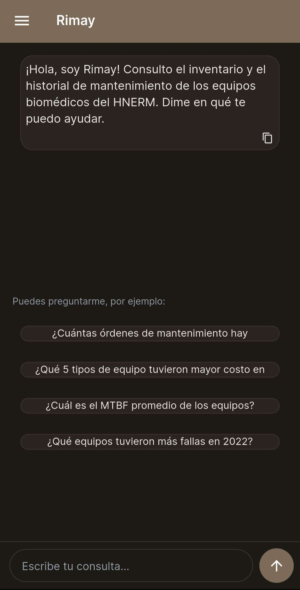
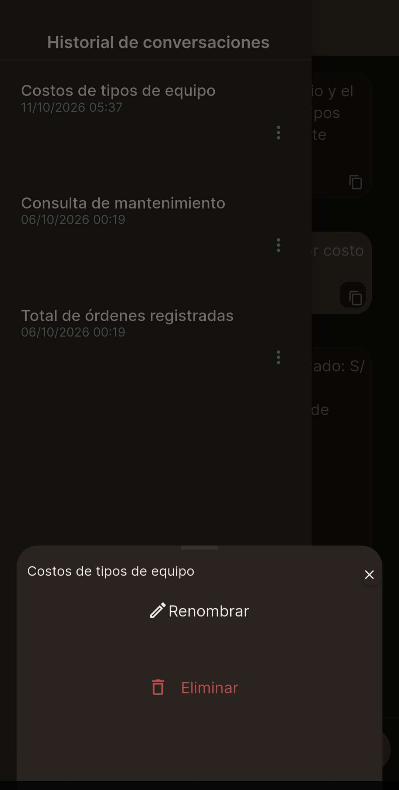
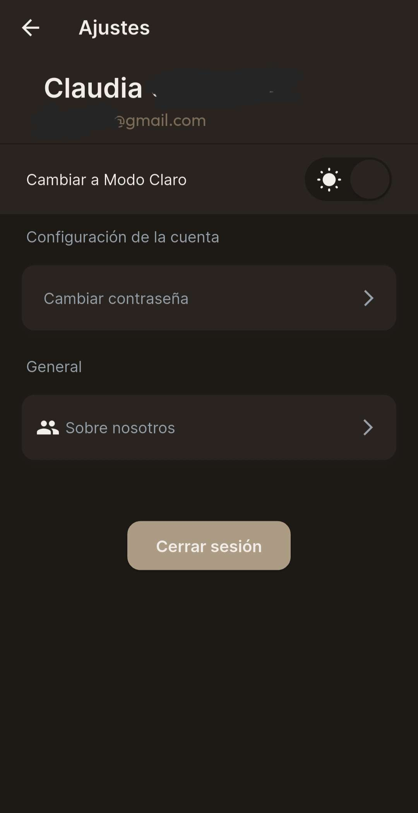
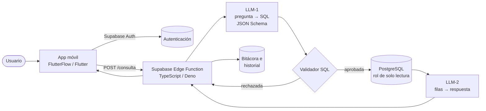

# Rimay — consulta en lenguaje natural para la gestión del mantenimiento biomédico

*Text-to-SQL assistant that lets hospital technicians query medical equipment maintenance records in plain language. Built with FlutterFlow and Supabase Edge Functions.*

**Rimay** (del quechua *rimay*, "hablar") es una aplicación móvil para el personal de ingeniería clínica. Permite consultar **en lenguaje natural** el historial de mantenimiento de los equipos biomédicos de un hospital nacional. El usuario escribe una pregunta, un modelo de lenguaje la traduce a SQL, el SQL pasa por varias capas de seguridad, se ejecuta sobre PostgreSQL y otro modelo redacta la respuesta a partir de los datos obtenidos.

> Ejemplo: *"¿Qué 5 tipos de equipo tuvieron mayor costo en 2022?"* → la app responde con la lista y los montos, y muestra el SQL que se ejecutó para que la respuesta sea verificable.

| Alcance de los datos | |
|---|---|
| Órdenes de trabajo de mantenimiento | 7 872 (2019–2022) |
| Equipos biomédicos | 1 412 (83 tipos de equipo) |
| Servicios asistenciales / empresas ejecutoras | 104 / 29 |

Es un prototipo de soporte a la gestión técnica: es de **solo lectura**, no modifica datos y no es un sistema clínico.

---

## Capturas

| Inicio de sesión | Pantalla inicial | Respuesta con SQL |
|:---:|:---:|:---:|
|  |  |  |
| **Historial de conversaciones** | **Renombrar / eliminar** | **Ajustes** |
|  |  |  |

---

## Arquitectura



**Flujo de una consulta**

1. La app envía la pregunta a la Edge Function `consulta`.
2. **LLM-1** (API de OpenAI, salida estructurada con JSON Schema) recibe solo el esquema autorizado y clasifica la pregunta: `SQL`, `NO_CALCULABLE`, `AMBIGUA`, `FUERA_DE_DOMINIO` o `CONVERSACION`. Si corresponde, genera el SQL y un título para la conversación.
3. El **validador SQL** revisa la sentencia antes de ejecutarla.
4. PostgreSQL la ejecuta con un **rol de solo lectura**, dentro de una transacción de solo lectura, con un límite de 8 s y como máximo 200 filas. Si falla, LLM-1 recibe el error y tiene un reintento.
5. **LLM-2** redacta la respuesta usando **solo** las filas obtenidas.
6. Se registra la consulta (tiempos, tokens, estado) y se guarda el historial de la conversación del usuario.

## Tecnologías

| Capa | Tecnología |
|---|---|
| Aplicación móvil | FlutterFlow (Flutter/Dart), Custom Actions en Dart |
| Autenticación | Supabase Auth: correo con verificación, Google OAuth, recuperación por código |
| Backend | Supabase Edge Functions (Deno/TypeScript) |
| Base de datos | PostgreSQL (Supabase) |
| Modelos de lenguaje | API de OpenAI (Responses API, salida estructurada) |
| Evaluación | Python (biblioteca estándar + psycopg2) |

## Base de datos

Modelo relacional normalizado con 6 tablas de dominio: `tipos_mantenimiento`, `tipos_equipo`, `servicios`, `ejecutores`, `equipos` y `ordenes_mantenimiento`. A estas se suman las tablas de soporte `consultas_log` (bitácora), `conversaciones` y `mensajes` (historial). Los scripts están en [`sql/`](sql).

Decisiones de diseño:
- El servicio se guarda en la orden, no en el equipo, porque hay equipos que fueron reubicados entre servicios.
- `num_otm` no es único en la fuente, así que la clave primaria es sustituta.
- Los indicadores (tasa de fallas, MTBF, razón de costos correctivo/preventivo, cumplimiento del preventivo) **se calculan dinámicamente con SQL** y no se almacenan.
- Los indicadores que el registro no permite calcular (MTTR, disponibilidad) se responden explícitamente como `NO_CALCULABLE`, en lugar de inventarse.

## Seguridad

1. **Validador léxico del SQL**: exige una sola sentencia `SELECT`/`WITH`, prohíbe comentarios, aplica una lista negra de 33 palabras (DML/DDL), bloquea catálogos del sistema (`pg_*`, `information_schema`, `auth.`) y usa una **lista blanca de tablas**.
2. **Rol `chatbot_lectura`** con permiso únicamente de `SELECT` sobre las 6 tablas de dominio.
3. **Transacción de solo lectura**, `statement_timeout` de 8 s y tope de filas.
4. **RLS activo** en todas las tablas, sin políticas para la app: ninguna tabla es accesible directamente desde el cliente.
5. Medidas contra *prompt injection*: el texto del usuario se trata como dato, la salida tiene tipos cerrados y lo que queda fuera de dominio recibe una respuesta fija.
6. Las claves (`OPENAI_API_KEY`) viven solo en los *secrets* de Supabase.

## Evaluación

El módulo Text-to-SQL se evaluó con un conjunto de **45 preguntas** (36 con SQL de referencia y 9 de rechazo), comparando el **resultado** de ejecutar cada consulta, no el texto del SQL.

| Métrica | Valor |
|---|---|
| Exactitud de ejecución estricta | 86,1 % (31/36) |
| Exactitud de ejecución relajada (admite columnas adicionales) | 100 % (36/36) |
| Rechazo correcto (inyección SQL, modificación de datos, fuera de dominio, no calculables) | 100 % (9/9) |
| Latencia mediana (LLM-1 + SQL) | ≈ 2,3 s |

*Nota:* es un conjunto de desarrollo, porque el prompt se ajustó con estas mismas preguntas. Para medir el rendimiento de forma independiente hace falta un conjunto de prueba nuevo.

## Estructura del repositorio

```
app/                          Código de la app exportado de FlutterFlow (claves reemplazadas)
supabase/functions/consulta/  Edge Function: orquestación, LLM-1, validador, LLM-2, historial
sql/                          Esquema, rol de solo lectura, RLS, carga e historial
evaluacion/                   Construcción del conjunto de evaluación y evaluador
docs/capturas/                Capturas de la aplicación
```

## Configuración

Este repositorio **no contiene claves ni datos**. Para ejecutarlo:

1. Crea un proyecto en Supabase y ejecuta los scripts de `sql/` en orden.
2. Despliega la función: `supabase functions deploy consulta` y configura el secret `OPENAI_API_KEY`.
3. En `app/`, reemplaza `TU_PROYECTO`, `TU_SUPABASE_ANON_KEY`, `TU_SUPABASE_PUBLISHABLE_KEY` y los `TU_GOOGLE_CLIENT_ID` por los valores de tu proyecto.
4. Evaluación: define `SUPABASE_URL` y `SUPABASE_KEY` y ejecuta `python evaluacion/evaluar.py`.

## Datos

Los registros de mantenimiento provienen de una institución de salud y **no se publican** en este repositorio. Tampoco se incluyen los resultados de la evaluación con filas reales.

## Autora

**Claudia Camacho Grimaldi** — Ingeniera biomédica (PUCP – UPCH)
[LinkedIn](https://www.linkedin.com/in/claudia-cg/) · clarox184@gmail.com
